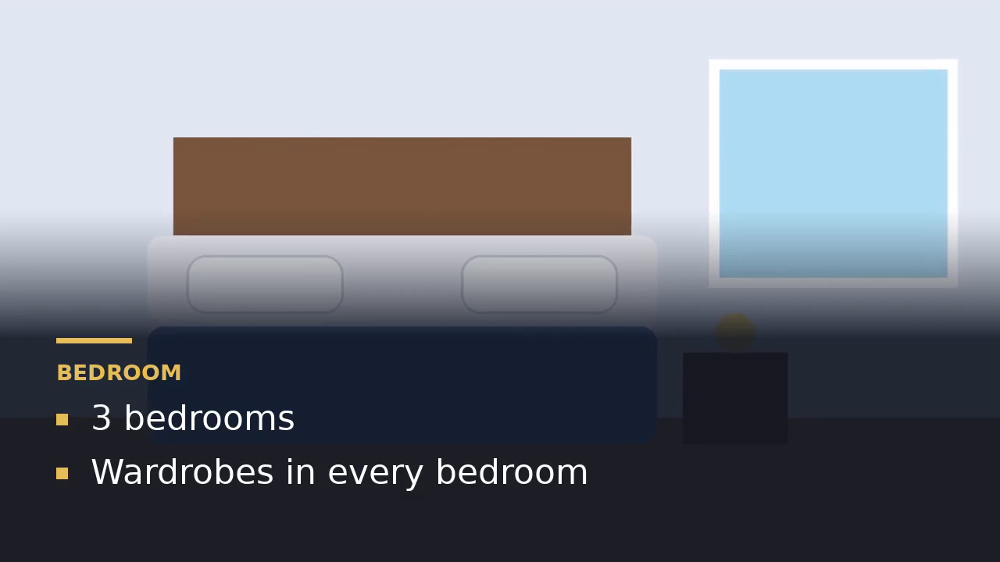

# AI Property Video Generator

Turn property details and 4-8 photos into a short promotional **MP4** in about a minute.
Built for a real-estate sales team that currently makes these videos by hand.

* The script and captions use **only the facts you type**. Nothing is invented (details in [How it works](#how-it-works)).
* By default no AI API key, internet connection or paid service is needed. An optional **AI voice-over polish** (own API key) can make the voice-over sound more natural; every AI sentence is validated against your facts.



---

## Quick start (Windows 11)

1. Install **Python 3.10 or newer** (tested with 3.13) from <https://www.python.org/downloads/> and tick **"Add python.exe to PATH"**.
2. Extract this folder anywhere (for example `Documents\property-video-generator`).
3. **Double-click `run.bat`.**
   The first run creates a virtual environment and installs the libraries (a few minutes). Your browser then opens the app.
4. In the app click **Load sample property** (fills the form and selects the bundled demo images) and then **Generate video**.

Manual way (PowerShell) if you prefer:

```powershell
cd path\to\property-video-generator
python -m venv venv
.\venv\Scripts\Activate.ps1          # if blocked: Set-ExecutionPolicy -Scope Process -ExecutionPolicy Bypass
python -m pip install -r requirements.txt
streamlit run app.py
```

Skip the UI and build the sample video from the command line:

```powershell
python scripts\generate_sample_video.py
```

## Using the app

| Step | What to do |
|---|---|
| 1 | Fill in name, location, currency + price, property type, key features (one per line or comma separated). Contact details and a call-to-action are optional |
| 2 | Upload **4-8 JPG/PNG images** (or choose the bundled sample images). A live counter tells you if the count is wrong. Under each photo you can type an **optional label** such as *Kitchen*; features are then shown with the matching photo |
| 3 | Pick the format: landscape 16:9 (1280x720) or vertical 9:16 (720x1280) |
| 4 | Click **Generate video**. A progress bar is shown while it renders (about 30-60 seconds for a 30 s video) |
| 5 | Watch the preview, then **Download MP4** (or download the script as text). The scene table and voice-over script are shown next to the video |

Generated files are also saved in `outputs/` (the newest 15 are kept automatically).

## Requirements coverage

| # | Requirement from the assignment | Where it is implemented |
|---|---|---|
| 1 | Accept name, location, price, type, key features, contact, call-to-action | `app.py` form, `src/validators.py` |
| 2 | Accept 4-8 images | `load_and_validate_images()` |
| 3 | Short promotional script + scene captions (AI or clearly explained template logic) | `src/script_generator.py` (template logic, explained below) |
| 4 | Use only supplied facts | Templates + `check_grounding()` guard + tests |
| 5 | Arrange images into scenes automatically | `generate_script()`: one scene per image: hook, intro, feature scenes, closing. Optional photo labels pull each feature onto the matching photo |
| 6 | Readable text overlays, transitions, optional narration / music | `src/video_generator.py`: Pillow text panels, cross-fade, slow zoom. Narration and music are optional and **not included** |
| 7 | Export MP4 | H.264 + yuv420p (plays in all browsers) |
| 8 | Preview and download | `st.video`, `st.download_button` |
| 9 | Handle missing info, invalid files, errors gracefully | Validators + friendly `VideoGenerationError`; see the test list |
| 10 | Source, sample data, sample MP4, README, dependencies, disclosure | This folder: `data/`, `outputs/sample_property_video.mp4`, `requirements.txt`, `DISCLOSURE.md` |

## How it works

```
 Form + images
      |
      v
 validators.py  -- cleans text, checks required fields, lengths, contact format,
      |            image count / real file type / corruption / size / EXIF rotation
      v
 script_generator.py -- fixed templates + user's facts  ->  Scene list (captions + voice-over)
      |                 check_grounding() rejects any number or word that is not supplied
      v
 video_generator.py -- for each scene: centre-crop image -> slow zoom -> draw caption panel (Pillow)
      |                scenes overlap by 0.8 s with a cross-fade -> FFmpeg (libx264) -> MP4
      v
 app.py -- progress bar, preview, download, scene table
```

**Scene plan** (one scene per image, uploaded order is kept, the first image is the opening shot and the last one carries the enquiry message):

1. **Hook** - property name + location (photo 1)
2. **Intro** - property type + price (photo 2)
3. **Feature scenes** - up to 3 of your features per photo, text copied exactly as typed
4. **Fact cards** - for spare photos: location / type / price, or just the photo's label (still your facts)
5. **Closing** - your call-to-action + contact details (the enquiry prompt) (last photo)

**Matching features to photos (rule-based).** The app cannot see what a photo shows, so you can type a short label
under each photo. A small matcher (lower-casing + plural stemming + word overlap, `match_score()` in
`src/script_generator.py`) puts each feature next to the photo whose label shares a word with it
(*Kitchen* <-> *Modular kitchen*, *Bedroom* <-> *3 bedrooms*). Features that match no photo are only placed on photos
that have **no** label, so you never see "bedroom" text on a kitchen photo. Anything that cannot be placed is listed in a
warning instead of being hidden. Without labels the app falls back to simple in-order placement.

**Video length:** 4-5 seconds per scene, so 4 images give about 21 s and 8 images about 33 s (target 20-40 s).

**Optional AI polish.** Expand *Advanced: AI voice-over polish*, tick the box and paste a Gemini or Anthropic key. The LLM only rephrases voice-over sentences (never on-screen captions). `validate_rewrite()` rejects any sentence with a new number, a word outside your facts/template words/a short neutral list, a dropped fact, or more than 35 words, and that scene keeps its template sentence. API errors also fall back to templates. This path is tested with fake LLM functions; it has not been run against a live API in my environment.

**Why templates by default and not only an LLM?** A real-estate video must never promise something that is not true. Templates
guarantee that, run offline, cost nothing and always work. The grounding check is also the safety net that
would make a future LLM rewrite safe (the LLM output would be rejected if it adds new numbers or claims).

**Why Pillow for text, not MoviePy's TextClip?** TextClip needs ImageMagick or font paths, the most common
Windows install problems. Pillow with a bundled font works everywhere.

## Project structure

```
app.py                      Streamlit user interface
run.bat                     One-click start for Windows
requirements.txt            Dependencies
src/config.py               All settings (limits, video size, timings, colours)
src/validators.py           Form and image validation
src/script_generator.py     Templates, scene plan, grounding check
src/music.py               Generated background music (optional)
src/llm_rewriter.py        Optional AI voice-over polish with safety checks
src/video_generator.py      Overlay drawing, zoom, cross-fade, MP4 export, progress
data/sample_property.json   Fictional demo property (with photo labels)
assets/sample_images/       7 synthetic illustrations for the demo (exterior, living room, bedroom, kitchen, bathroom, parking, balcony)
assets/fonts/               DejaVu Sans (bundled font) + licence
outputs/                    Generated videos (sample_property_video.mp4 is included)
scripts/                    make_sample_images.py, generate_sample_video.py
tests/                      103 automated tests
DISCLOSURE.md               Models, APIs, libraries and assets used
DEMO_SCRIPT.md              Demo walkthrough and likely questions
TEST_RESULTS.md             Actual test results
```

## Configuration

Everything you may want to change is in `src/config.py`: image count limits, maximum text lengths, video sizes,
frames per second, seconds per scene, fade length, zoom amount and colours.

## Tests

```powershell
python -m pytest tests -q                 # everything (~2 minutes, renders real videos)
python -m pytest tests -q -m "not slow"   # fast tests only (a few seconds)
```

See `TEST_RESULTS.md` for the actual results and what each test covers.

## Limitations (honest list)

* **No narration.** The voice-over script is shown as text only. Optional soft background music (original, generated by `src/music.py`) can be switched on with a checkbox, or you can upload your own MP3/WAV/M4A (max 15 MB; it is looped or cut to the video length and faded in/out). Both are off by default. If you upload your own track, make sure you have the right to use it.
* Captions are English template sentences. Names you type in other scripts (e.g. Hindi) work only if the bundled font has those glyphs; DejaVu Sans covers Latin, Cyrillic and Greek but not Devanagari.
* The app cannot recognise what a photo shows. Photos are used in upload order and feature-to-photo matching relies on the optional labels you type. Without labels, feature captions are placed in order and may not match the picture behind them.
* With only 4 images the video has one feature scene, which fits up to 3 features; the rest are listed as "did not fit" with a warning. Upload more images to show more.
* Very long locations (close to the 100 character limit) are shortened with "..." in the vertical format.
* Rendering uses the CPU only: expect about 30-60 s for a 30 s video on a normal laptop.

## Future improvements

Text-to-speech narration (offline `pyttsx3` or a cloud voice), licensed background music, optional LLM rewriting
of captions guarded by `check_grounding()`, automatic photo ordering with an image classifier, more aspect ratios
and batch generation for a whole listing sheet.

## Troubleshooting

| Problem | Fix |
|---|---|
| `Python was not found` | Install Python from python.org and tick "Add python.exe to PATH". Reopen the window |
| `running scripts is disabled` in PowerShell | `Set-ExecutionPolicy -Scope Process -ExecutionPolicy Bypass`, then activate again. (`run.bat` does not need this) |
| `pip install` fails on a very new Python | Install Python 3.11 or 3.12 and delete the `venv` folder, then run `run.bat` again |
| Setup was interrupted | Delete the `venv` folder and run `run.bat` again |
| Port already in use | Close the older black window, or run `streamlit run app.py --server.port 8600` |
| Video does not play in the preview | Use **Download MP4** and open it in VLC or Windows Media Player. Check that the file is not 0 KB |
| `PermissionError` while exporting | Close any player that has the same video open and try again |
| "Your disk is full" | Free some space. Old generated videos can be deleted from `outputs/` |
| Rendering is slow or memory error | Use fewer or smaller images, or the 16:9 format. Close other heavy programs |
| Image rejected | Check the message: only real JPG/PNG files, at least 400 px on the short side, up to 15 MB each |
